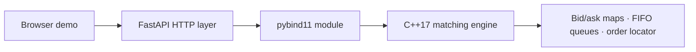

# C++ Matching Engine

A single-instrument limit order book and matching engine written in C++17, with Python bindings and a small HTTP demo. It accepts limit and market orders, applies price-time priority, emits acknowledgement/fill/cancel/reject events, and exposes aggregated top-of-book depth.

The C++ engine is the core of the project. FastAPI is a thin demo layer for submitting orders and visualizing the live in-memory book; it is not an exchange gateway or a production trading service.

> **Attribution:** The original C++ engine implementation was created by [Shane Woloszyn](https://github.com/ShaneWoloszyn/cpp-matching-engine) and copied with permission. This repository adds the browser/API demo and container deployment setup.

## What it demonstrates

- **Price-time priority:** the best price executes first; orders resting at the same price are consumed FIFO.
- **Matching and order handling:** limit and market orders, partial fills, IOC and FOK behavior, cancellation, duplicate-ID and input validation.
- **Order book data structures:** separate ordered price maps for bids and asks, FIFO `std::list` queues at each price, and a hash-map locator for resting orders. Locator lookup is expected O(1); price-level lookup/removal is O(log P), where P is the number of price levels.
- **Observable state:** best bid/ask and aggregated depth, returned alongside explicit engine events.
- **C++/Python integration:** a C++17 static engine is exposed through pybind11 and used by a FastAPI demo.
- **Invariant checks:** an O(N) checker validates level totals, non-crossed book state, and locator consistency; it is intended for tests/debugging, not the matching hot path.

## Architecture



The engine processes each submitted request synchronously. The demo serializes access with a lock and runs one API worker so the in-memory book has one owner.

## Interactive demo and API

The browser demo starts with a small sample spread. Place buy/sell limit or market orders and observe acknowledgements, fills, cancellations, rejects, and book depth.

| Method | Endpoint | Purpose |
|---|---|---|
| `GET` | `/` | Interactive order book and order-entry page |
| `GET` | `/api/health` | Health check |
| `GET` | `/api/book?depth=10` | Best prices and up to 50 aggregated levels per side |
| `POST` | `/api/orders` | Submit a limit or market order |
| `DELETE` | `/api/orders/{order_id}` | Cancel a resting order |
| `GET` | `/docs` | OpenAPI/Swagger interface |

Example request:

```bash
curl -X POST http://localhost:8000/api/orders \
  -H 'Content-Type: application/json' \
  -d '{"side":"buy","type":"limit","tif":"gtc","price":100,"quantity":5}'
```

The API assigns order IDs. A response contains the submitted ID, the engine events, and a fresh book snapshot. A trade creates one fill event for each side of the trade, so the event stream describes both counterparties.

## Build and run locally

### Requirements

- CMake 3.20 or newer
- GCC 11+ or Clang 13+ (or a compatible MSVC C++17 toolchain)
- Python 3.10+
- Git (CMake fetches pybind11 during configuration)

Build the C++ engine and Python extension:

```bash
cmake -S . -B build -DCMAKE_BUILD_TYPE=Release
cmake --build build --parallel
cmake --install build
```

Install the web-layer dependencies and start the demo from the repository root:

```bash
python -m pip install -r requirements.txt
PYTHONPATH="$PWD/tests" python -m uvicorn app.main:app --reload --port 8000
```

On Windows PowerShell, set the module path before starting Uvicorn:

```powershell
python -m pip install -r requirements.txt
$env:PYTHONPATH = "$PWD\tests"
python -m uvicorn app.main:app --reload --port 8000
```

Open `http://localhost:8000` for the UI or `http://localhost:8000/docs` for the API explorer.

## Tests

The repository contains 29 pytest cases for resting orders, full and partial fills, price/time priority, IOC/FOK/market behavior, cancellation, validation, book depth, and a randomized 5,000-operation invariant stress test.

```bash
python -m pip install pytest
python -m pytest tests -v
```

## Benchmark

Build configuration uses `Release`/`-O3`. For local machine-specific measurements, configure with `-DMATCHING_ENGINE_NATIVE_ARCH=ON`; that option uses `-march=native` and may produce binaries that do not run on other CPU models. The benchmark uses a deterministic synthetic workload of one million operations by default: 60% passive limits, 20% aggressive IOC limits, 10% market orders, and 10% cancels. Pass a different operation count as the first argument, for example `./build/bench 1000000`.

An earlier README snapshot reported 2.43 million operations/second and 300 ns p50 latency. The benchmark does not record the machine/compiler configuration, includes workload generation and per-operation clock reads, and notes roughly 10 ns of timing overhead. Treat that number as an unverified historical result, not a portable performance claim. Re-run the benchmark on the target machine and record its CPU, compiler, build flags, operation count, and results before quoting it in a résumé.

## Deploy the demo

The repository includes a Dockerfile and a Render Blueprint (`render.yaml`). To publish it, connect this GitHub repository to Render and create a Blueprint from the repo. Render builds the C++ extension inside Docker and serves the demo at the generated `onrender.com` URL. The health check is `/api/health`; the API explorer is available at `/docs`.

The included Blueprint selects Render's free web-service plan. Free services can spin down after inactivity, so the first request may take time to wake the demo. The demo book is in memory and resets on a restart or deploy. See Render's [web service](https://render.com/docs/web-services), [Blueprint](https://render.com/docs/blueprint-spec), and [free plan](https://render.com/docs/free) documentation for current service behavior.

## Scope and limitations

- The browser demo is a shared, single-process simulation: visitors interact with the same in-memory order book.
- Orders and state are not persisted. Restarting or redeploying resets the sample book and all submitted orders.
- The API has no authentication, accounts, balances, risk checks, rate limiting, or durable event log. Do not send real orders or connect it to a broker.
- The C++ engine itself is not thread-safe. The demo uses a process-local lock and one Uvicorn worker; adding multiple workers would create independent books.
- `TimeInForce::Day` exists in the C++ enum/binding, but session-expiry behavior is not implemented. The demo therefore exposes only GTC, IOC, and FOK.
- The benchmark is a synthetic microbenchmark, not a production exchange performance test.

## Next engineering steps

1. Add independent reference-model replay tests and boundary/property-based checks.
2. Record reproducible benchmark metadata and compare multiple data structures/workloads.
3. Add persistence, account/risk controls, isolation, and observability only if evolving the demo toward a service.
4. Profile allocation and cache behavior before replacing the ordered maps or list queues.
